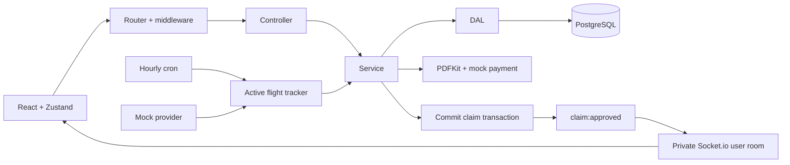

# SureFlight

An event-driven flight disruption tracker with a React/TypeScript passenger dashboard, Express API, PostgreSQL persistence, private Socket.io notifications, PDF claim packages, and a simulated payment gateway.

## Run locally

Requires Node.js 22 or later and npm. The supplied, git-ignored `backend/.env` configures an in-memory demo with a randomly generated JWT secret. No external flight API or payment credentials are needed.

In two terminals:

```powershell
# Terminal 1, from the repository root
cd backend
npm install
npm run dev
```

```powershell
# Terminal 2, from the repository root
cd frontend
npm install
npm run dev
```

Open **http://localhost:5173**. API: **http://localhost:4000**; health: **http://localhost:4000/health**.

Demo credentials: **demo@sureflight.local** / **SureFlight123!**. The explicit `DEMO_SEED=true` setting creates an administrator and three sample flights, including a mock paid claim. Other users can register normally. A demo administrator can simulate a disruption from the flights view. Ordinary users cannot update flight statuses.

In-memory data resets when the backend restarts. Disable `DEMO_SEED` to start empty. Memory mode needs development dependencies (`pg-mem`) installed; it is rejected in production.

If `.env` is absent, copy `backend/.env.example` to `backend/.env`, set `DB_MODE=memory`, leave `DB_URL` empty, and replace `JWT_SECRET` with random bytes. Generate a secret using `node -e "console.log(require('node:crypto').randomBytes(48).toString('hex'))"`. Set `PORT=4000`, and optionally `DEMO_SEED=true` for the demo.

## PostgreSQL / Supabase

1. Create a PostgreSQL database, or obtain your Supabase project's PostgreSQL connection string (direct connection or session pooler) from its connection settings.
2. Set `DB_MODE=postgres`, `DB_URL=<connection string>`, `DEMO_SEED=false`, and a private random `JWT_SECRET` in `backend/.env`. For Supabase set `DB_SSL=true`; certificates are validated. For a private CA, configure Node's trusted CA using `NODE_EXTRA_CA_CERTS`.
3. Run `npm run db:migrate` from `backend`. Startup also applies the idempotent schema. SQL lives in `backend/db/schema.sql`; PostgreSQL-only RLS settings live in `backend/db/security.sql`.
4. Start the backend and frontend as above.

Only the backend receives the database credentials. Its database role must own the application tables or have the required RLS bypass privileges. Row-level security is enabled without public policies, preventing direct access through Supabase's public REST API. Application queries independently enforce ownership. Use a dedicated database/schema for this project and a controlled migration process when evolving an existing deployment.

For production set `NODE_ENV=production`, `CLIENT_ORIGIN` to the exact frontend origin, and configure HTTPS, database backups, a process supervisor, reverse-proxy trust/rate limiting, and static hosting for `frontend/dist`. The frontend defaults to same-origin `/api` and Socket.io. Vite's development proxy forwards both to port 4000. Optional `VITE_API_URL` (for example `https://api.example.com/api`) and `VITE_SOCKET_URL` (for example `https://api.example.com`) can target a separate backend; neither may contain a secret.

## Architecture and files

The root of this workspace is the requested `my-project` directory. The existing proposal document is preserved.

```text
backend/
  app.js                  Express composition, startup, sockets, shutdown
  db/                     pg pool, schema, migration, memory adapter
  routers/                Endpoints and middleware wiring only
  controllers/            Request/response handling only
  services/               Authentication, flights, registration, claims, providers, cron
  DAL/                    Parameterized SQL queries and persistence mapping only
  middleware/             JWT, role, validation, error boundaries
  validation/             Strict Zod body and UUID parameter schemas
  utils/                  Passwords, tokens, errors, Haversine, PDF generation
  tests/                  Rule, scheduler, HTTP/transaction/realtime verification
frontend/
  src/App.tsx             Routing and authenticated layout
  src/pages/              Login, dashboard, flights list/form, claims, profile
  src/components/         Common UI, layout, ProtectedRoute
  src/services/           Axios and typed resource API calls
  src/store/              Zustand authentication, flight, claim, notification state
  src/types/              Shared API domain definitions
  src/hooks/              Authenticated WebSocket lifecycle
```



## Business behavior

- Registration computes great-circle distance locally from airport coordinates. No flight-provider request occurs at registration.
- Flights departing more than 24 hours away start as `PENDING_ACTIVE`; nearer flights start as `ACTIVE_TRACKING`. An hourly UTC cron (`0 * * * *`) activates pending flights with departure at or before now plus 24 hours, including flights missed during downtime. Startup runs one catch-up pass.
- Only active flights are polled. Provider failures are isolated per flight and retried on a later pass. Overlapping ticks in one process are skipped. Run one scheduler instance; multi-replica deployments require a distributed scheduler/lease.
- At **480 minutes or more**, or on cancellation, the configured compensation policy yields **ILS 1,530** for distances up to 2,000 km, **ILS 2,450** above 2,000 through 4,500 km, and **ILS 3,670** above 4,500 km. Fractional distances are not rounded before tier selection. Delayed arrivals also qualify when the reported delay reaches the threshold.
- Terminal cancellations and landings are preserved against stale status reversals. Tracking becomes `COMPLETED` after processing their claims.
- PNRs are six alphanumeric characters, normalized to uppercase. `UNIQUE(flight_id, pnr)` applies across all passengers. A canonical flight is unique by flight number and scheduled departure. Contradictory route details for that identity are rejected.
- Each tracked booking can have one claim. Claim generation locks the flight row in a database transaction, creates missing claim records, generates PDF bytes, simulates payment, and persists `PAID`, its mock transaction ID, and PDF bytes together. Failures roll back all claims from that transaction. Stable booking-based payment idempotency keys support retry.
- `CLAIM_APPROVED` is emitted only after commit to a JWT-authenticated `user:<id>` room. Clients cannot select another passenger's room. Offline/reconnected clients fetch persisted claims. Socket sessions disconnect when the JWT expires.
- Claim packages are downloaded through an authenticated, ownership-checked endpoint. Registrations with claims cannot be deleted.

This implements the supplied **prototype policy**, not a complete legal determination under EU261 or Israeli aviation law. Jurisdiction, statutory updates, exclusions, notification periods, and passenger evidence are not evaluated. PNR uniqueness is duplicate prevention, not verification that someone owns the booking. Airport coordinates are supplied by the user; production should resolve verified schedules/airports from a trusted source. No airline submission or real payment occurs.

The mock provider returns stored disruptions and marks flights landed after their scheduled arrival plus delay. An administrator can inject delay/cancellation via the guarded status endpoint. The provider interface is `getStatus(flight) -> { status, delayMinutes }`; unsupported provider names fail at startup rather than silently pretending to use live data. Add a validated AirLabs/FlightAware adapter, timeouts, retries, and provider credentials before enabling live tracking.

A real payment gateway cannot be rolled back by a SQL transaction. Before handling real money, replace the simulated in-transaction call with a durable outbox/worker, gateway idempotency, receipt reconciliation, and a recoverable claim state machine. The current PDF and mock payout operations intentionally follow the requested atomic demo workflow.

## HTTP API

JSON responses use `{ "data": ... }`; errors use `{ "error": { "code": "...", "message": "..." } }`. Protected requests use `Authorization: Bearer <token>`. All times use ISO 8601 with an offset; responses are UTC. The form converts browser-local dates to UTC and the UI displays local time.

| Method | Endpoint | Behavior |
| --- | --- | --- |
| POST | `/api/auth/register` | `{name,email,password}` → user and JWT |
| POST | `/api/auth/login` | `{email,password}` → user and JWT |
| GET | `/api/auth/me` | Current user |
| GET/PATCH | `/api/users/me` | Read profile / update `{name}` |
| GET | `/api/flights` | Flight catalog, without passenger data |
| GET | `/api/flights/:id` | Flight details |
| PATCH | `/api/flights/:id/status` | Mock administrator: `{status,delayMinutes}` |
| GET | `/api/trackedFlights` | Own registered flights |
| POST | `/api/trackedFlights` | `{pnr,flight:{...}}` → local distance and registration |
| GET/DELETE | `/api/trackedFlights/:id` | Own registration; deletion blocked if it has a claim |
| GET | `/api/claims` | Own claims |
| GET | `/api/claims/:id` | Own claim |
| GET | `/api/claims/:id/pdf` | Own PDF as an attachment |

The flight registration object includes `flightNumber`, `airline`, `departureAirport`, `arrivalAirport`, `departureLat`, `departureLon`, `arrivalLat`, `arrivalLon`, `scheduledDeparture`, and `scheduledArrival`. Departure must be in the future and arrival after departure. Airport codes use three letters.

Claims and flight observations are produced by the workflow, so clients have no arbitrary create/update/delete endpoints for claims. Public registration always creates the `USER` role; administrator provisioning belongs to trusted operations.

## Verification

```powershell
cd backend
npm test
npm run check
```

```powershell
cd frontend
npm run typecheck
npm run build
```

Backend tests use isolated in-memory PostgreSQL-compatible databases and ephemeral HTTP ports. They exercise distance/threshold boundaries, activation timing, provider failures, authentication/ownership, PNR uniqueness, PDF creation, transactional rollback, concurrent retries, and private notifications. Memory transactions use serialized snapshot/restore because `pg-mem` does not implement PostgreSQL rollback. Actual PostgreSQL locking, RLS, and TLS behavior require integration verification against your configured PostgreSQL instance.

Verified locally: 15 backend tests pass, strict TypeScript and the Vite production build pass, and npm reports zero known vulnerabilities in both dependency trees. Browser checks covered demo login, future-flight registration, an eight-hour mock disruption, the immediate claim notification, and downloading the new PDF. Mobile layout and desktop navigation were checked, with no browser console errors. PostgreSQL/Supabase integration has not been exercised here because no database credentials or running PostgreSQL server were supplied.

Frontend styling uses Tailwind 4's PostCSS integration and its explicit JavaScript theme configuration, following the [official upgrade guide](https://tailwindcss.com/docs/upgrade-guide).

## Configuration

| Variable | Purpose |
| --- | --- |
| `DB_MODE` | `postgres` (default) or local-only `memory` |
| `DB_URL` | PostgreSQL connection string; server-only |
| `DB_SSL` | `true` to require TLS with certificate validation |
| `JWT_SECRET` | Private, random secret, minimum 32 characters |
| `PORT` | API listener, set to `4000` for the supplied Vite proxy |
| `CLIENT_ORIGIN` | Allowed frontend origin, typically `http://localhost:5173` |
| `FLIGHT_PROVIDER` | `mock` |
| `TRACKER_ENABLED` | `false` disables scheduled polling |
| `DEMO_SEED` | Explicit `true` creates sample administrator and flights |
| `NODE_ENV` | Use `production` outside local development |

Keep `.env`, credentials, PDFs, and passenger data out of source control and logs. Passwords use bcrypt, JWTs are signed and expiring, payloads are strictly validated, SQL is parameterized, and HTTP authentication endpoints are rate limited.
